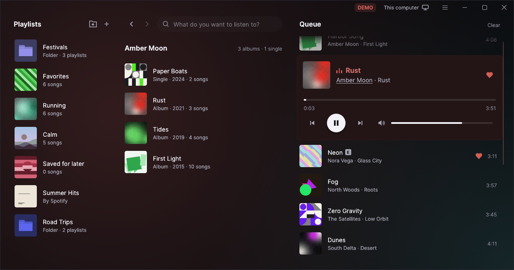
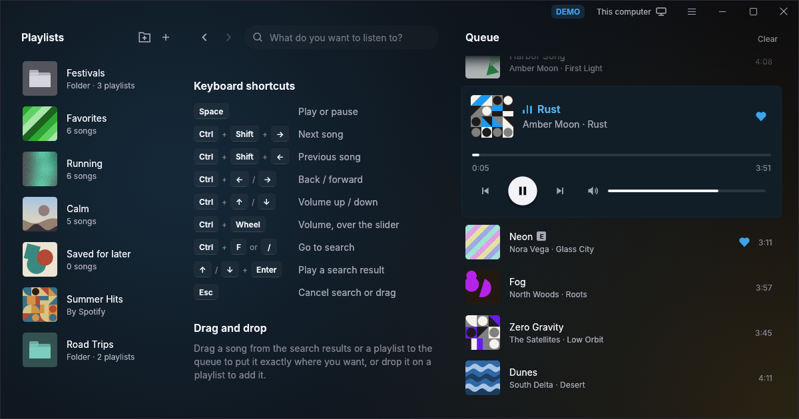
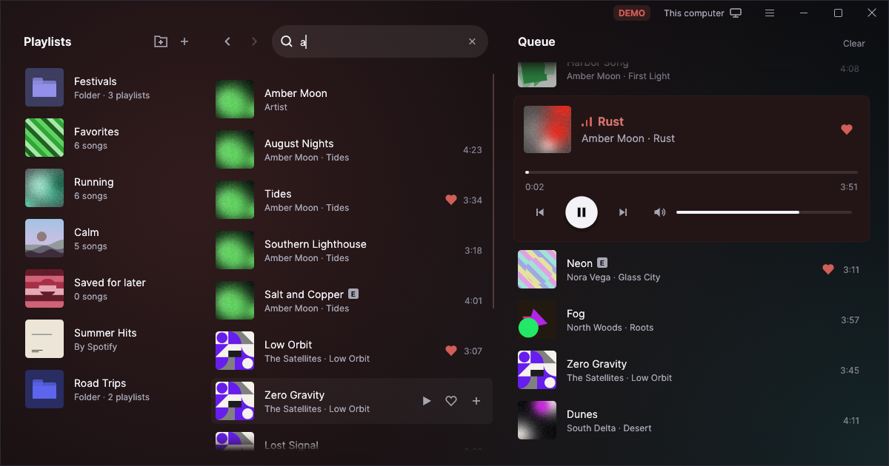
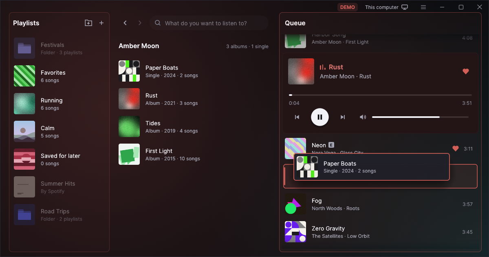
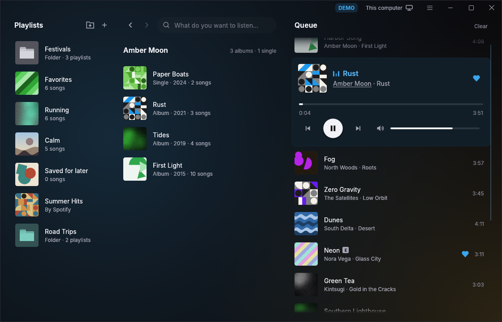

# Melodia

A desktop player for [Spotify](https://www.spotify.com) on Windows.

The official Spotify's app has a lot of things that I don't need, so I made a simpler player focused on music and playlists. No podcasts. No marketing from genres that I don't like. Just my music.

I started Melodia as a personal project. But if you like it, you can use it too!



## Screenshots

| Keyboard shortcuts | Search |
| --- | --- |
|  |  |
| **Dragging to the queue** | **Albums and artists** |
|  |  |

## Requirements

- Windows 10/11 x64
- Spotify Premium. Free accounts cannot use the app.

## How to install

Melodia is for personal use. Each person must connect it to their own Spotify app and Client ID.

1. **Download the installer** from the [download page](https://github.com/nuzkito/melodia/releases).
   Then run the installer.
2. **If Windows stops the installer** (SmartScreen), click **More info**. Then click **Run anyway**.
   The installer is not signed at this time.
3. **Create an app in the Spotify Developer Dashboard** at <https://developer.spotify.com/dashboard>.
   Click **Create app**. You can give the app any name. In **Redirect URIs**, add this address
   exactly: `http://127.0.0.1:8898/callback`
4. **Select the APIs.** In the same form, select **Web API** and **Web Playback SDK**. Then save
   the app.
5. **Copy the Client ID.** Open the **Settings** of your app. The Client ID has 32 letters and
   numbers.
6. **Connect Melodia to Spotify.** Open Melodia and paste the Client ID. Then click **Connect to
   Spotify**. A browser opens a Spotify page. Accept the request on that page. Your playlists then
   show in Melodia.

### Check the download

To make sure that the file is correct, open PowerShell in the folder of the file and run the
command for that file. The hash must be the same as in `SHA256SUMS.txt` on the download page.

```powershell
Get-FileHash .\Melodia-0.1.0-setup.exe                 # the installer
Get-FileHash .\melodia-0.1.0-windows-x64-portable.zip  # the portable version
```

### Installer, portable version and uninstaller

- **Installer**: Run `Melodia-0.1.0-setup.exe`. It puts the app in `%LOCALAPPDATA%\Programs\Melodia`.
  It adds a Start menu folder, an optional desktop shortcut and an entry in *Settings → Apps*.
- **Portable version**: Extract `melodia-0.1.0-windows-x64-portable.zip` and open
  `melodia-0.1.0-portable.exe`. Keep `WebView2Loader.dll` in the same folder. Without this file, the
  app does not start.
- **Update**: Install the new version over the old version. Your settings and session stay.
- **Uninstaller**: Use *Settings → Apps* or *Start → Melodia → Uninstall Melodia*. The uninstaller
  keeps your settings and session in `%APPDATA%\Melodia`. It deletes them only if you select
  **Also delete my settings and Spotify session**. A silent uninstall always keeps them:
  `"%LOCALAPPDATA%\Programs\Melodia\uninstall.exe" /S`

The user guide, with the keyboard shortcuts, is in [docs/features.md](docs/features.md).

## Limitations

- Spotify limits the number of requests that the app can send.
- If Spotify says that the app sends too many requests, the app waits. Until then, the app shows “Spotify is limiting requests. Try again in N s.”
- The app stores the playlist order and the folders only on this computer. The Web API cannot read or make the folders of your Spotify library.
- Podcasts and audiobooks are not supported.

## Development

All builds and tests run in Docker containers. The host needs only Docker.

### Commands

Run these commands in the project folder:

```bash
docker compose run --rm test                      # tests
docker compose run --rm lint                      # rustfmt and clippy
MELODIA_DEMO=1 docker compose run --rm app        # app in demo mode (through WSLg)
```

The demo mode uses fake tracks and cover art, as in the screenshots. It does not need an account.

The [landing page](web/index.html) shows the app and explains how to install it. Run `make web` to
serve it on <http://127.0.0.1:8897>.

### Build the installer

Run this command in WSL, in the project folder. The first build takes several minutes.

```bash
docker compose run --rm build-release
```

To embed the Client ID in the app, add `SPOTIFY_CLIENT_ID=...` before the command.

The build creates these files in `dist/`:

| File | Purpose |
| --- | --- |
| `Melodia-0.1.0-setup.exe` | Installer |
| `melodia.exe` | The application |
| `WebView2Loader.dll` | Necessary next to `melodia.exe` (without it, the app does not start) |
| `melodia-0.1.0-windows-x64-portable.zip` | Portable version: the two files above, with the `.exe` renamed to `melodia-0.1.0-portable.exe` |
| `SHA256SUMS.txt` | The SHA-256 hashes of the installer and the zip. Publish it with them |

To copy the installer to Windows, run this command:

```bash
cp dist/Melodia-0.1.0-setup.exe /mnt/c/Users/<your-user>/Downloads/
```

### Configuration

The table lists the environment variables and their defaults.

| Variable | Default | Description |
| --- | --- | --- |
| `SPOTIFY_CLIENT_ID` | — | The Client ID of your Spotify app. It has priority over the Client ID saved in the app. |
| `MELODIA_PORT` | `8898` | The port of the Redirect URI. Use `0` for a random free port. Then register `http://127.0.0.1/callback` without a port. |
| `MELODIA_CONFIG_DIR` | `%APPDATA%\Melodia\config` | The folder for settings, session and log. |
| `MELODIA_DEMO` / `--demo` | — | Demo mode with fake data. |
| `MELODIA_RENDERER` | `wgpu` | Use `glow` to use OpenGL instead of wgpu. |
| `WGPU_BACKEND` | `dx12` on Windows | The graphics API of wgpu: `dx12`, `vulkan` or `opengl`. |
| `MELODIA_WEB_DEBUG` | — | Use `1` to show the “Play in this app” window with DevTools. |
| `MELODIA_UPDATE_URL` | `http://127.0.0.1:8897/version.json` | The address where the app looks for new versions. Builds without it use the development server. The `build-dev` and `build-release` services use `https://melodia.nuzkito.es/version.json`. |
| `RUST_LOG` | `warn,melodia=info` | The log level. |

The configuration folder contains these files:

- `settings.json`: the Client ID, the volume, the playlist order and the position of the music.
- `session.json`: the tokens. On Windows, they are encrypted: only your Windows user can read them.
- `cache.json`: the recent data. You can delete it.
- `queue.json`: the queue.
- `melodia.log`: the log.

### Troubleshooting

For the solutions to common problems, see [docs/troubleshooting.md](docs/troubleshooting.md).

### Stack

The app uses these main technologies:

- Rust.
- [egui](https://github.com/emilk/egui) and eframe, with wgpu. OpenGL is the fallback.
- Tokio, for the background tasks.
- reqwest with rustls, for the HTTP requests.
- OAuth 2.0 with PKCE, for the sign-in.
- WebView2, for the Web Playback SDK.

[AGENTS.md](AGENTS.md) and the files in [docs/](docs/) are for coding agents, and coding agents
maintain them. They describe the architecture, the commands, the tests and the conventions.
